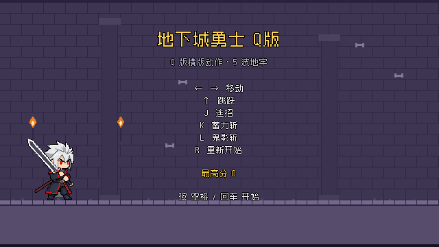

# 地下城勇士 Q 版（dnfm-arena）

Q 版 DNF 手游核心玩法复刻 —— 横版动作战斗 + 波次刷图 + 掉落成长 + 结算评级。
Godot 4.7.2 / 640×360 逻辑画布 / tile 16 / 像素风（hibit 32 色）。



---

## 一、启动方式

### 桌面运行（开发）

```bash
cd D:/my-projects/games/dnfm-arena/godot
"D:/apps/Godot/4.7.2/Godot_v4.7.2-stable_win64_console.exe" --path .
```

> `--path` 必须指向**含 project.godot 的那一级**（即 `.../dnfm-arena/godot`），
> 指向工程根会报 `Failed loading resource: res://scripts/player.gd`。

### 无头冒烟（CI / 自检）

```bash
cd D:/my-projects/games/dnfm-arena/godot
"D:/apps/Godot/4.7.2/Godot_v4.7.2-stable_win64_console.exe" --headless --path . res://smoke_test.tscn
```

期望输出末行 `SMOKE PASS`（35 项检查 0 失败），退出码 0。

### 截图（必须带窗口，`--headless` 会卡死）

```bash
cd D:/my-projects/games/dnfm-arena/godot
"D:/apps/Godot/4.7.2/Godot_v4.7.2-stable_win64_console.exe" --path . res://screenshot.tscn -- play "D:/my-projects/games/dnfm-arena/docs/shots/play.png"
```

参数：`title` | `play` | `result`，输出路径必须是**绝对路径且带 .png**。

### Android APK

```bash
export JAVA_HOME="D:/apps/jdk-17"; export PATH="$JAVA_HOME/bin:$PATH"
export ANDROID_HOME="D:/apps/android-sdk"; export ANDROID_SDK_ROOT="D:/apps/android-sdk"
cd D:/my-projects/games/dnfm-arena
"D:/apps/Godot/4.7.2/Godot_v4.7.2-stable_win64_console.exe" --headless --path godot \
  --export-debug Android "D:/my-projects/games/dnfm-arena/build/dnfm-arena.apk"
```

产物：`build/dnfm-arena.apk`（30,469,418 B）
`com.pixelstudio.dnfmarena` / v1.0.0 (code 1) / minSdk 24 / targetSdk 36 / arm64-v8a。

---

## 二、操作说明

| 操作 | 键盘 | 触屏 |
|---|---|---|
| 移动 | ← / → 或 A / D | 左下虚拟摇杆 |
| 跳跃 | 空格 / W / ↑ | 右下圆形「跳」键 |
| 普攻（三段连招） | J | 右下「攻」键 |
| 蓄力斩（技能） | K | 右侧「技」键 |
| 鬼影斩（大招） | L | 右侧「鬼」键 |
| 开始游戏 | 空格 / 回车 | 点屏幕任意处 |
| 重新挑战 | R | 结算页「按 R 重新挑战」提示（触屏暂无按钮，见已知限制） |

**连招机制**：三段普攻伤害 4 / 4 / 6，判定窗口 0.16 / 0.16 / 0.22 秒，
冷却 0.30 秒，连招续接窗口 1.2 秒 —— 在窗口内再按攻击键即接续下一段。
第三段命中会触发连击计数（HUD 显示「N 连击」，10 连击起换大字号）。

---

## 三、已实现功能

### 核心战斗
- 三段普攻连招（4/4/6 伤害，实例级去重，一次挥击对同一敌人只结算一次）
- 两档技能：蓄力斩（伤害 14 / 范围 40 / CD 1.2s）、鬼影斩（伤害 26 / 范围 62 / CD 3.0s）
- 受击硬直 + 击退 + 无敌帧 0.7s + 闪红
- 连击计数 HUD（2 连起显示，10 连换 24 号字）

### 敌人 AI
- 两种兵种：绿皮哥布林（HP26/速56/攻距26/伤4/间隔0.9s）与橙皮壮汉（HP70/速38/攻距36/伤9/间隔1.5s）
- 追击 → 进入攻击距离停下挥击 → 冷却后再次攻击
- 敌人之间轻微互斥防止穿模；壮汉击退减半

### 波次与刷图
- 5 波共 14 只怪，间隔 0.35s 逐个入场，清场后 1.6s 推进下一波
- 掉落：靠近 14px 自动拾取；哥布林 60% 金币 / 40% 经验，壮汉 40% 金币 / 60% 经验
- 成长：经验满自动升级，max_hp +4、伤害 +15%，升级需求 30 × 1.35ⁿ

### 场景与视觉
- 4 段色阶渐变地牢背景、错缝砖墙、3 根石柱、4 支呼吸火把、固定种子碎石装饰
- 地面合并为单一矩形碰撞体（960×64），角色不会卡缝
- 8 套 Q 版像素动画（待机 / 呼吸 / 行走 / 普攻 / 蓄力斩 / 鬼影斩 / 哥布林行走 / 壮汉行走），96×96，hibit 32 色

### 界面与音频
- 标题页（标题 + 操作表 + 历史最高分 + 开始提示闪烁）
- 战斗 HUD（血条 / 经验条 / 等级 / 金币 / 波次 / 连击）
- 波次横幅（"第 N 波 / 清光所有敌人"）
- 结算页（遮罩 + 面板 + 6 行数据 + S/A/B/C 评级 + R 重开提示）
- 1 首 BGM + 8 条音效（BGM loop_end 按 `get_length()*mix_rate` 计算）

### 触屏
- 静态摇杆（死区 0.20，按下当帧即出方向，不等拖拽）
- 5 个动作键（跳 / 攻 / 技 / 鬼），热区 ≥44 逻辑像素
- 按 index 追踪多指，一指一角色，拖摇杆不误触发跳跃
- 按 `DisplayServer.get_display_safe_area()` 内缩，避开刘海与手势条

---

## 四、代码结构（分层清晰）

| 文件 | 行数 | 职责 |
|---|---|---|
| `godot/scripts/game_config.gd` | 93 | 全部数值常量真源（速度/跳跃/连招/技能/波次/配色/路径） |
| `godot/scripts/player.gd` | 598 | 角色控制 + 战斗状态机 + 连招 + 技能 + 受伤无敌 + 升级 |
| `godot/scripts/enemy.gd` | 405 | 敌人 AI（追击/攻击/互斥/受击死亡）+ 兵种数值 |
| `godot/scripts/world.gd` | 302 | 地牢场景构建（背景/砖墙/石柱/火把/地面碰撞） |
| `godot/scripts/pickup.gd` | 163 | 掉落物（金币/经验）+ 距离拾取 + 浮动动画 |
| `godot/scripts/hud.gd` | 507 | HUD / 标题页 / 横幅 / 结算页（多根节点互斥切换） |
| `godot/scripts/touch_controls.gd` | 552 | 触屏摇杆与动作键 |
| `godot/scripts/main.gd` | 535 | 主控：状态机 / 波次编排 / 掉落结算 / 音频池 / 相机 |
| `godot/scripts/screenshot.gd` | 59 | 截图工具 |
| `godot/smoke_test.gd` | ~200 | 无头自检 35 项 |

模块间只通过信号与契约方法通信，具体约定见 `docs/contracts.md`（8 章）。

---

## 五、验证结果

| 项目 | 结果 |
|---|---|
| 像素素材验收 `verify_assets.py` | 8 实体 / 0 问题 / 0 告警 |
| 无头冒烟 `smoke_test.tscn` | 35 项 / 0 失败 / SMOKE PASS |
| 全工程解析 `--headless --quit` | 0 SCRIPT ERROR（仅退出期资源未释放告警，无害） |
| 截图核验 | title / play / result 三屏无串屏、无溢出 |
| APK 导出 | 30,469,418 B，aapt2 badging 与签名均通过，182 条目无测试脚本混入 |

---

## 六、已知限制 / 待完善

1. **无真机验证环境**：本机无 Android emulator、`adb devices` 为空，APK 未在真机安装运行过；触控手感需实机验证。
2. **结算页无触屏「重新挑战」按钮**：只支持 R 键。补一个按钮即可。
3. **仅一个关卡场景**：无多关卡、无 BOSS、无地图切换。
4. **敌人只有 2 种兵种、4 帧行走动画**：没有受击/死亡动画，敌人死亡直接消失（可加受击闪帧与消散特效）。
5. **角色技能无范围特效表现**：鬼影斩只有判定框与伤害，没有刀光/冲击波视觉。
6. **成长系统只有等级与伤害加成**：无装备、无技能树、无属性点。
7. **BGM 与音效复用同门工程素材**，未针对本项目重制。
8. **像素风 UI 精度有限**：HUD 为纯色块 + 描边，未使用 NinePatch 面板与渐变按钮（可参考技能包 `mobile-ui-ux.md` 第 5 章）。
9. **玩家精灵复用同门工程 Q 版鬼剑士素材**，本项目新增资产只有 2 套敌人。
10. **未做多端打包**：本轮只导出了 Android debug APK，Windows / Web 导出未配置。

---

## 七、素材来源

- 玩家 6 套动作：复用同门像素工程「Q 版鬼剑士」素材（改名 hero_*），保证 Q 版风格 100% 一致
- 哥布林 / 壮汉 2 套行走：本机 ComfyUI（z-image-turbo）本地生成 → 抠底 → 量化 → NEAREST 缩放 → 验收
- 音效 9 条：复用同门工程
- 字体 zpix.ttf：12px 点阵像素字体
- 全部为原创或自制素材，未使用任何受版权保护的商业素材
